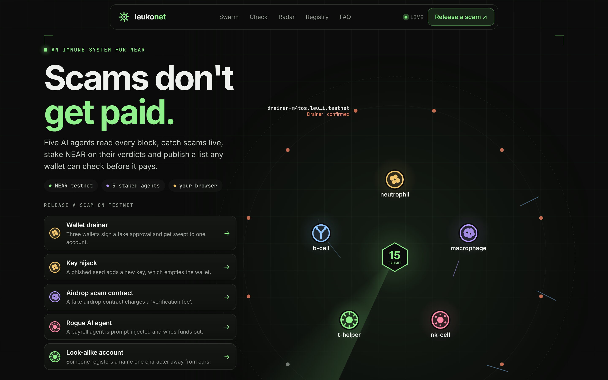

<p align="center"></p>

# Leukonet

**An immune system for NEAR. Scams don't get paid.** Five AI sentinel agents read every NEAR block as it lands, catch scams as they happen, and stake NEAR on their verdicts in an onchain registry. Any wallet, person or AI agent can ask before it pays.

[](https://github.com/carynyx80/leukonet/actions/workflows/ci.yml)


Built for **NEAR HACKATHON 2026**. Tracks: **AI Security & Defense**, **AI Swarms**, **Agent Economy**, **Open Innovation**.

| | |
|---|---|
| **Live demo** | **https://leukonet.vercel.app**: release a scam, watch it get caught in ~20 s |
| **MCP endpoint** (for AI agents) | `https://swarm-production-38a8.up.railway.app/mcp` |
| **Chrome extension** | [`leukonet-guard.zip`](https://leukonet.vercel.app/leukonet-guard.zip) · source in [`extension/`](extension/) |
| Registry contract (testnet) | [`registry.leukonet-mw43jm6i.testnet`](https://testnet.nearblocks.io/address/registry.leukonet-mw43jm6i.testnet) |
| Stack | Rust (near-sdk 5) · TypeScript (near-api-js 7) · React · MCP SDK · FastNear neardata · NEAR AI Cloud |
| Demo script | [`docs/DEMO.md`](docs/DEMO.md): the 2-minute walkthrough |
| License | MIT |

**In 30 seconds:** open the live demo, click *Wallet drainer*. Three wallets get swept on testnet; within seconds an agent spots it (often your own browser first), stakes on a report, four others re-check it on chain and vote, the registry confirms it, and a guarded payment agent refuses to pay the thief. Every step has a transaction link.

---

## The problem

AI agents are starting to hold wallets and pay each other. Wallet drainers, stolen keys, fake airdrop contracts and look-alike account names already take money from people. They will take it from agents faster, because agents pay without hesitating. Warnings about scam accounts today live in Discord threads and X posts, hours after the money is gone. Nothing machine-readable answers "should I pay this account?" while it still matters.

## What Leukonet does

1. **Watch.** The swarm follows the chain head in real time, about one block a second, scanning every transaction on testnet.
2. **Flag.** Each sentinel specialises in one threat. When it sees one, it files a report in the registry contract and **stakes NEAR** on it.
3. **Verify.** The other sentinels re-check the evidence on chain with their **own thresholds** and vote with their own stake. If the swarm disagrees, the wrong side loses its stake to the right side. False accusations cost money.
4. **Protect.** Confirmed threats go into a public registry. One free view call, `is_safe(account_id)`, tells a wallet or agent whether to pay.
5. **Remember.** Once a scam contract is confirmed, its code hash goes into **immune memory**. The same code deployed under any new name is caught on sight.
6. **Recruit.** Every person who opens the site becomes part of the immune system: their browser reads the chain itself, runs the same detectors, and tips the swarm. See below.

On testnet the whole loop takes about **10–15 seconds** from the attack to the onchain verdict. That's measured in our runs: drainer 10s, key hijack 14s, scam contract 14s, and a scam-code redeploy caught from memory 9s.

### The five sentinels

| Sentinel | Specialty | What it catches |
|---|---|---|
| `neutrophil` | first responder | **Drainer**: one account receives full-balance sweeps from 3+ wallets. **Key hijack**: a newly added full-access key empties its own account. |
| `macrophage` | contracts | **Malicious contract**: newly deployed code exposing lure methods (`claim_airdrop`, `verify_wallet`, …), or code already in immune memory. |
| `nk-cell` | agents | **Rogue agent**: an account with a steady payment pattern suddenly pays a new payee ≥10× its median. |
| `t-helper` | names, coordinator | **Look-alike**: a new account one edit or homoglyph away from a protected name (`leuk0net-pay` vs `leukonet-pay`). It also closes finished votes. |
| `b-cell` | sceptic | Files nothing. Re-checks every report with the strictest thresholds, so it is the sentinel most likely to vote against. |

Each sentinel is its **own NEAR account** with its own bond. They share no keys.

## Every visitor is a white blood cell

Open https://leukonet.vercel.app and your browser joins the swarm. It streams NEAR blocks straight from FastNear's neardata over **your own connection**, runs the **exact same detector code** as the sentinels (`src/detectors/*`, shared by server and browser), and sends anything it finds to the swarm as a **tip** (`POST /api/tip`). The page shows how many transactions your browser has checked, how many browsers are watching right now, and credits you when your tip leads to a catch.

Why this matters:

- **The more people watch, the stronger it gets.** Watching is spread across every visitor instead of resting on one server, so no single machine or rate limit is a point of failure. A free data feed that throttles one cloud server serves thousands of browsers comfortably.
- **Tips are untrusted.** A tip carries transaction hashes, not conclusions. The sentinel that owns that kind of finding re-checks it **on chain, with its own thresholds** (the transactions exist, go between the claimed accounts, the accused account exists, the code exposes lure methods) before it files or stakes anything. A forged tip costs the forger nothing and costs the swarm one cheap lookup.
- **Abuse-resistant by construction.** Tips are shape-checked (known detector and category, valid account id, real-looking tx hashes, 8 KB cap), rate-limited per address (20 a minute), de-duplicated, and limited to the demo's own accounts, so a tip can never get a stranger accused.

Devtools: `window.leukonetCell.stats` shows what your tab has checked.

## Mainnet radar

The same detectors, pointed at **NEAR mainnet**, from your browser, read-only (section *Mainnet radar* on the site). One click starts a live scan for the two highest-signal patterns: new accounts named to imitate famous ones (`ref-flnance.near` vs `ref-finance.near`, `rnintbase1.near` vs `mintbase1.near`, 28 protected names) and contracts exposing airdrop-lure methods. Findings are shown with explorer links and **never reported**. Drainer and rogue-agent patterns are deliberately left out on mainnet: exchanges sweeping deposit accounts look like drainers, and flagging them would be wrong. There is also an instant *"Would this name fool people?"* check that runs the look-alike logic on any name you type.

## How NEAR is used

- **Registry contract** (`contracts/registry`, Rust). Bonds, staked reports, staked votes, finalisation with stake redistribution, and the public `is_safe` view. Everything happens onchain: every flag, vote and verdict has a transaction hash.
- **Named sub-accounts.** Each sentinel and each demo actor is a sub-account of one master (`neutrophil.leukonet-….testnet`).
- **Access keys as a signal.** Key-hijack detection relies on NEAR's access-key model. A transfer signed by a full-access key added minutes earlier is the signature of a phished seed phrase.
- **Account naming.** Look-alike detection uses NEAR's human-readable names and the `testnet` registrar.
- **FastNear neardata.** One request returns a whole block, with every transaction and each signer's post-transaction balance, so the swarm keeps up with ~1s blocks.
- **NEAR AI Cloud** (optional). When `NEAR_AI_API_KEY` is set, the reporting sentinel turns the evidence into one plain-English sentence, which is stored onchain as the report summary.

## Try it: judge walkthrough

**Fastest: the live site.** Open https://leukonet.vercel.app, pick a scam under *Release a scam on testnet*, and watch the six-step tracker go Attack → Spotted → Reported → Voted → Confirmed → Blocked. The swarm backend runs on a single shared cloud server whose free data feed is rate-limited; your browser's own watcher covers for it, and if neither is in sync the buttons say so instead of failing.

**Fully local** (no shared limits). You need Node ≥ 20 and Rust (with `rustup`). Everything runs on **testnet** and is free.

```bash
git clone <this repo> && cd leukonet
npm install
npm run setup        # creates a testnet account via the faucet, builds + deploys the registry,
                     # creates 5 sentinel accounts with bonds, registers a protected name
npm run build:web
npm start            # swarm + threat map on http://localhost:8787
```

Then, in the browser at `http://localhost:8787`:

| Do this | You should see |
|---|---|
| Open the page | The live map: streaks are real testnet transactions flowing to the agent that inspects them. A green card says **"Your browser is a white blood cell"** and the *tx checked by your browser* counter climbs. |
| Click **Wallet drainer** under *Release a scam on testnet* | The left column turns into a live mission: a stopwatch and six steps. Three wallets are swept (every step has a `tx ↗` link under *Every step*). |
| Wait ~10–20 s | **Spotted** (often "Your browser spotted it first"), **Reported** (neutrophil stakes 0.02 NEAR), **Voted** (the four other agents re-check and confirm, one tile each), **Confirmed**, then **Blocked**: "Payment blocked: guarded payment agent refused to send 0.05 NEAR". |
| Scroll to **Check before you pay**, click the drainer under *Try* | **Do not pay this account** · Drainer · risk 90/100. |
| Release **Airdrop scam contract** twice | First run: caught by `malicious_contract` (lure methods); b-cell's card says it now remembers the code. Second run: same code, new name, caught from **immune memory**. |
| Try **Key hijack**, **Rogue AI agent**, **Look-alike account** | Each is caught by its specialist and confirmed onchain. |
| Open **Mainnet radar**, click **Scan NEAR mainnet live**; type `ref-flnance.near` | Live mainnet counters; the name check answers "Imitates ref-finance.near". |

The same from the terminal (with `npm start` running):

```bash
npm run attack -- drainer            # also: key_hijack, malicious_contract, rogue_agent, lookalike
npm run check -- <account.testnet>   # ✗ <account>: Drainer (risk 90/100, reports 0)
npm run example:guarded-agent        # pays a safe supplier, refuses the latest confirmed threat
npm test                             # contract tests (Rust) + detector tests (TypeScript)
```

Or check the deployed registry directly, without installing anything:

```bash
curl -s https://rpc.testnet.fastnear.com -H 'Content-Type: application/json' -d '{"jsonrpc":"2.0","id":1,"method":"query","params":{"request_type":"call_function","finality":"final","account_id":"registry.leukonet-mw43jm6i.testnet","method_name":"get_stats","args_base64":"e30="}}' \
  | python3 -c "import json,sys; print(bytes(json.load(sys.stdin)['result']['result']).decode())"
```

## Use it from your wallet or agent

```ts
import { guarded, checkBeforePay, LeukonetBlocked } from "./src/sdk/guard";

const opts = { registry: "registry.leukonet-mw43jm6i.testnet" };

const check = await checkBeforePay("someone.testnet", opts);
// { safe: false, risk: 90, categories: ["Drainer"], report_ids: [0], pending_reports: [] }

await guarded("someone.testnet", opts, () => pay("someone.testnet", amount)); // throws LeukonetBlocked
```

`guarded` wraps any payment function. Options: `blockPending: true` also refuses while a report is still being voted on, and `maxRisk` sets the risk threshold.

### From any AI agent: MCP

Leukonet is an MCP server. Hosted (no install): `https://swarm-production-38a8.up.railway.app/mcp` (streamable HTTP). Local: `npm run mcp` (stdio).

```json
{ "mcpServers": { "leukonet": { "command": "npx", "args": ["tsx", "/path/to/leukonet/src/mcp/stdio.ts"] } } }
```

| Tool | What it answers |
|---|---|
| `check_payment(to, amount_near?, strict?)` | **ALLOW** or **BLOCK**, with the reason. The one to call before every payment. |
| `check_account(account_id)` | Verdict, risk, categories, open reports. |
| `check_name(name)` | Does this name imitate one of 28 famous mainnet accounts? (offline) |
| `recent_reports(status?, limit?)`, `get_report(report_id)` | The registry's reports, evidence and every vote. |
| `swarm_status()` | Sentinels, bonds, track records, totals. |

All tools are read-only views on the registry contract: no wallet, no key, no fee.

### From your browser: Leukonet Guard

A Chrome extension (`extension/`, or download `leukonet-guard.zip` from the live site's developer section; unzip and *Load unpacked* in `chrome://extensions`):

- check any account from the toolbar popup;
- right-click selected text, *Check with Leukonet*;
- on NearBlocks, MyNearWallet, Meteor and a few others, confirmed scam accounts are marked **SCAM** and names imitating famous accounts **IMPOSTOR**, as the page loads. On any other page, *Scan this page* in the popup does the same once.

It never changes forms or links and sends nothing anywhere except `is_safe` view calls to the RPC. Build: `npm run build:extension`.

## Run your own sentinel

The swarm is not meant to be five agents run by one person. Anyone can join with their own account and their own rules:

```bash
OPERATOR_ACCOUNT_ID=you.testnet OPERATOR_PRIVATE_KEY=ed25519:... npm run sentinel
# optional: OPERATOR_PROFILE=neutrophil|macrophage|nk-cell|t-helper|b-cell (default b-cell, the strictest)
```

It locks the registry's minimum bond, then for every open report re-reads the evidence **from the chain** with its own thresholds and votes with stake. It trusts nothing the hosted swarm says. The hosted swarm waits for every registered sentinel (or the 20 s window) before closing a report, so independent votes always count. Right votes earn a share of the losing side's stake; wrong ones lose theirs.

## Contract interface

| Method | Kind | What it does |
|---|---|---|
| `register_sentinel()` | payable | Join the swarm by locking a bond (≥ 0.2 NEAR on the demo deployment). |
| `flag(target, category, severity, summary, evidence)` | payable | Open a report, staking ≥ 0.02 NEAR. If a report on the same account and category is already open, this counts as a supporting vote. |
| `vote(report_id, support, note)` | payable | Confirm or dispute an open report with stake. One vote per sentinel. |
| `finalize(report_id)` | call | Anyone can close a report once the 20s window ends, or early once ≥ 3 sentinels agree unanimously. Confirmed needs ≥ 66% of the stake. Winners split the losers' stake pro rata; with too few votes, everyone is refunded. |
| `is_safe(account_id)` | view | `{ safe, risk, categories, report_ids, pending_reports }` |
| `get_reports`, `get_report`, `get_sentinels`, `get_verdicts`, `get_stats`, `get_config` | view | Everything the dashboard shows. |
| `clear_verdict`, `set_config` | owner | Override for a proven false positive, and tuning. |

Events are logged as `EVENT_JSON` (`flagged`, `voted`, `finalized`, `sentinel_joined`).

## Architecture

```
 testnet blocks ──► BlockStream (neardata, ~1 block/s, retries, RPC fallback)
                        │
                        ▼
             detectors: drainer · key_hijack · malicious_contract(+memory) · rogue_agent · lookalike
                        │ finding
                        ▼
   owner sentinel ──explain (NEAR AI)──► flag + stake ──►  registry contract  ◄── is_safe() ── wallets / agents
                                                             ▲          │
   other sentinels ── re-check evidence, own thresholds ── vote + stake  │
   t-helper ──────────────────────────────────────────────── finalize ───┘
                        │
                        ▼
            Hub ──SSE──► React threat map (web/)
```

```
contracts/registry   Rust registry contract + unit tests
contracts/bait       ~1.6 KB raw-wasm fake airdrop used by the simulator (testnet only)
src/stream.ts        real-time block streamer
src/detectors/       the five detectors (pure, unit-tested)
src/sentinel.ts      sentinel personas, filing and voting
src/swarm.ts         orchestration, registry polling, immune memory
src/sim/             attack simulator and normal background traffic
src/sdk/guard.ts     checkBeforePay / guarded
src/mcp/             MCP server (stdio + hosted /mcp)
src/operator/        run-your-own-sentinel
extension/           Leukonet Guard Chrome extension
src/main.ts          server: swarm + SSE + static dashboard
web/                 React dashboard
examples/            guarded payment agent
test/                detector tests
```

## Safety and honesty notes

- **Simulated attacks only touch demo accounts.** The attack simulator only creates and moves funds between sub-accounts of the demo's own master account, plus one look-alike top-level name it registers itself. It returns the funds afterwards by deleting the throwaway accounts.
- **The swarm doesn't accuse strangers.** By default (`FLAG_SCOPE=demo`) sentinels only stake on accounts that belong to the demo. Suspicious patterns on public testnet appear on the dashboard as *observed* and are never reported onchain. Setting `FLAG_SCOPE=all` lifts this.
- **The detectors are heuristics.** They're tuned to the attack patterns they target. Staking and independent re-checking exist so that the swarm can disagree and a single bad call costs its maker. The contract owner can clear a proven false positive.
- **NEAR AI is optional.** Without `NEAR_AI_API_KEY`, report summaries use each detector's own one-line reason.
- **Mainnet watch mode** (`WATCH_MAINNET=1`) scans mainnet read-only against well-known names and never writes.
- **Funds watchdog.** Every report and vote stakes testnet NEAR. The server checks balances every minute, tops up agents that run low from the master account, and pauses simulations (with a notice on the site) before the master is too low to finish one.
- **Restarts lose nothing.** Helper and attack accounts use keys derived from the master key, and the cleanup queue lives on a persistent volume, so a redeploy never strands NEAR in throwaway accounts.
- **Mainnet.** Every default (RPC, data feed, explorer) follows `NEAR_NETWORK=mainnet`; simulations and background traffic are off there by default, and `npm run setup` refuses to spend real NEAR without `--i-understand-this-spends-real-near` and your own funded account.

## Hackathon disclosure

All code in this repository was written during the NEAR HACKATHON window, starting from an empty repository, with AI assistance (Claude Code). Libraries used: `near-sdk`, `near-api-js`, `@modelcontextprotocol/sdk`, `zod`, `react`, `vite`, `esbuild`, `dotenv`, `tsx`. Data comes from FastNear (neardata, RPC). It is not derived from any earlier project.
